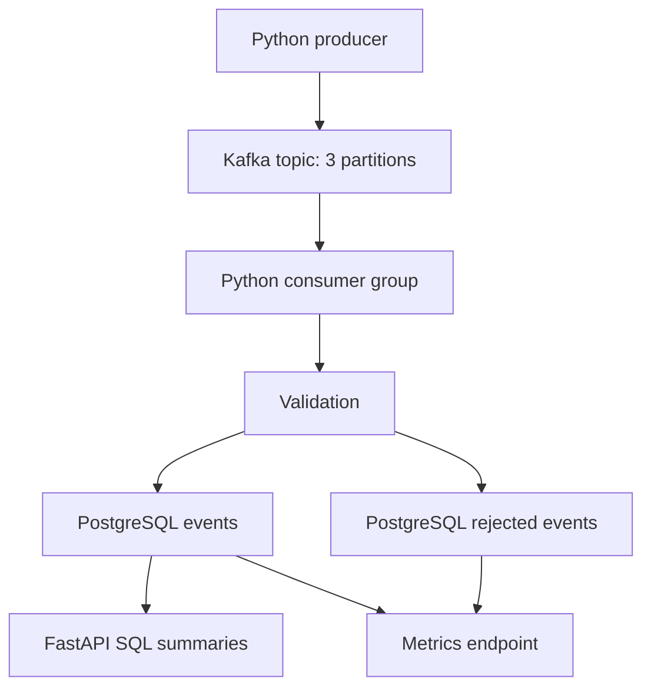

# Real-Time Analytics Platform

A Python event pipeline: generate application events, send them through Kafka, persist them in PostgreSQL, and query traffic, response-time, and error summaries through FastAPI.

**Implemented stack:** Python, kafka-python, Apache Kafka, psycopg2, PostgreSQL, FastAPI, and Docker Compose for local infrastructure. There is no Go service, Redis integration, React dashboard, or Grafana configuration in this repository.

**Performance status:** the previously cited 5,000+ events/sec, sub-two-second aggregation, 500,000 events, six consumers, and 99%+ success are not verified by repository benchmark evidence. The original producer slept 0.5 seconds and flushed every message; that is a demonstration workload of at most about two events/sec, not a throughput test.

## Engineering behavior

- Bounded producer with asynchronous sends, batched broker flush, acknowledgement checks, optional rate control, and a run UUID.
- Strict event validation: UUIDs, timezone-aware timestamps, bounded strings/numbers, known event types, and a 16 KiB consumer payload limit.
- Consumer polls up to 500 records, writes one database transaction, then commits explicit Kafka partition offsets. Database failure stops processing without acknowledging that batch.
- Unique `event_id` storage makes replay idempotent. Malformed events are quarantined by topic/partition/offset; payloads are not retained or logged.
- Bounded consumer memory; database-derived summaries replace unbounded in-memory user sets and per-event console output.
- Schema initialization, configuration examples, SQL timeouts, connection cleanup, dependency-aware readiness, safe 503 errors, metrics, and tests.

See [validation](docs/VALIDATION.md) for executed checks and unverified integrations.

## Architecture



Offsets are acknowledged **after** the SQL transaction. A crash between SQL commit and offset commit replays the batch; `ON CONFLICT DO NOTHING` suppresses duplicate event rows. This is at-least-once processing with idempotent storage, not a distributed exactly-once transaction. A failed Kafka commit also exits, allowing replay after restart. Rejected events must be stored successfully before their offsets advance. Raw rejected payloads are discarded, so there is no payload replay tool yet.

## Reproducible local setup

Requires Python 3.12+, Docker Engine, and Docker Compose v2. Run Python processes on the host: Kafka advertises `localhost:9092`.

```bash
python3 -m venv .venv
source .venv/bin/activate
pip install -r requirements.lock
cp .env.example .env
# Edit BOTH password placeholders consistently before continuing.
set -a
. ./.env
set +a
docker compose up -d --wait
# For a fresh volume, Compose initializes sql/schema.sql automatically.
python -m common.storage
python -m consumer.main
```

In another terminal, activate the same virtual environment and export the same `.env` values, then run:

```bash
python -m producer.main --count 100 --rate 2
uvicorn api.main:app --host 127.0.0.1 --port 8000
```

The schema script is idempotent for the new schema; it is **not** a migration for an existing manually created `events` table. Existing installations must add UUID keys, `run_id`, and `ingested_at` through a reviewed migration. Do not discard data to work around schema mismatch.

Docker Compose reads `.env` for infrastructure interpolation. Python reads process environment only; the explicit shell export is required. Never commit `.env`. Infrastructure ports bind to loopback. The one-node plaintext broker is a local demonstration; it is not suitable for public hosting or high availability. Kafka data is ephemeral; PostgreSQL uses a named volume. `docker compose down` stops services without deleting the PostgreSQL volume.

## API and instrumentation

```bash
curl http://127.0.0.1:8000/health
curl http://127.0.0.1:8000/ready
curl http://127.0.0.1:8000/analytics/summary
curl http://127.0.0.1:8000/analytics/event-types
curl http://127.0.0.1:8000/analytics/pages
curl http://127.0.0.1:8000/metrics
```

`/health` is process liveness; `/ready` checks the event table. Summary values include stored event count, unique users, average response time, error count, and percentage error rate. SQL empty-table summaries return zero. `/metrics` exports database-backed gauges for stored and rejected rows, not Kafka lag or a latency histogram. Consumer JSON logs record batch size, inserts, duplicates, rejections, and elapsed time. Dependency failures log error types without connection strings or raw events. Swagger UI is at `/docs`.

## Verification and measurement

```bash
python -m pytest -q -m 'not integration' --cov=common --cov=consumer --cov=producer --cov=api --cov=benchmarks
ruff check .
ruff format --check .
# With local Kafka/PostgreSQL ready:
RUN_INTEGRATION=1 python -m pytest -q -m integration
python -m benchmarks.pipeline --count 10000 --rate 0 --drain-timeout 60 \
  --output benchmarks/results/run.json
```

See [benchmark methodology](benchmarks/README.md). GitHub Actions defines unit and service-integration jobs, including a small end-to-end benchmark smoke run. A workflow definition is not evidence of a successful remote run. The local review environment has no Docker runtime. GitHub CI subsequently passed real PostgreSQL integration and a 500-event Kafka-to-database smoke at an imposed 100 events/sec. See validation evidence for that limited result; sustained capacity and the original resume numbers remain unverified.

## Trade-offs and remaining gaps

Batching reduces SQL and broker round trips but adds queueing delay. PostgreSQL is the single durable sink, simplifying truth for analytics; full-table aggregates will need time windows or materialized rollups at scale. Three partitions bound useful parallel consumers in one group to three. Connections are opened per API request with a five-second connect timeout and ten-second statement timeout; pooling and concurrency limits remain future work.

Next: verify the entire stack; add failure/restart and consumer-rebalance tests; measure lag, drain time, p95/p99 latency, duplicates, and rejection rate; add schema migrations and retention; then consider Redis or a dashboard if measurements justify them. Authentication, TLS, broker replication, access control, durable Kafka volumes, alerting, and production deployment are not implemented. No deployment is published by these changes.

`requirements.lock` pins the full Python 3.12 development environment used for validation. `requirements-dev.txt` and the runtime requirements describe direct dependencies; regenerate the lock deliberately when updating them.
